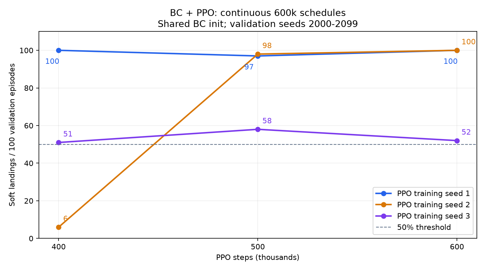

# Pre-merge audit: PPO fine-tuned from a behavior-cloned PD controller

The W3 frozen evaluations meet the stated Gate 2 point-estimate threshold of
50% for all three training seeds: **100%, 99%, and 54%**. Near-perfect performance
is **not robust across training seeds**. Seed 3's Wilson 95% interval is
44.3–63.4%, and its validation performance stays near 50% through 600k steps.
No merge, push, Kaggle launch, or three-seed full run was performed in this audit.
The follow-up PPO-only launch preparation is recorded below.

## Protocol and stability

Each PPO training seed (1, 2, 3) starts from the same committed PD BC actor and
normalization checkpoint. BC itself was not retrained for each seed. Each PPO
run has one continuous 600,000-step schedule, with complete runner snapshots at
400k and 500k and a final checkpoint at 600k. Optimizer state, RNG, observation
statistics, and environment state continue across snapshot boundaries. A
regression test compares the segmented scan with an uninterrupted scan.

This differs from the previous 300k and 500k experiments, which were independent
runs annealed to their own endpoints. Those earlier two results were not points
on one learning curve. All other settings match the earlier BC validation:
16 environments, 125 rollout steps, training reward_mode=1, potential scale 100,
gamma .995, optimizer reward scale .01, initial log-std -1.5, and no reward tweaks.

Validation seeds 2000–2099, deterministic mean actions; cells are **soft / crash /
timeout**, each out of 100:

| PPO training seed | 400k | 500k | 600k |
|---|---|---|---|
| 1 | 100 / 0 / 0 | 97 / 3 / 0 | 100 / 0 / 0 |
| 2 | 6 / 94 / 0 | 98 / 2 / 0 | 100 / 0 / 0 |
| 3 | 51 / 49 / 0 | 58 / 42 / 0 | 52 / 48 / 0 |



All three training runs and all nine validation evaluations finished before
any frozen result was read. The **500k snapshot was predeclared for each seed**;
neither checkpoint selection nor tuning used frozen results.

## W3 frozen results

The driver registers each checkpoint with `storage.db` and calls the actual
`eval.run_eval.run_evaluation` implementation, with no custom policy. W3 restores
the saved actor and normalization, computes outcomes via `eval.metrics`, and
writes SQLite evaluation rows plus per-episode Parquet trajectories.

Frozen seeds **10000–10099**, exactly 100 per checkpoint:

| Training seed | Soft | Crash | Timeout | Wilson 95% interval | W3 run/eval ID |
|---|---:|---:|---:|---|---|
| 1 | 100 | 0 | 0 | 96.3–100.0% | 1 / 1 |
| 2 | 99 | 1 | 0 | 94.6–99.8% | 2 / 2 |
| 3 | 54 | 46 | 0 | 44.3–63.4% | 3 / 3 |

These are the 500k snapshots of the new 600k schedules, not the old standalone
500k checkpoint. Local W3 evidence is in
`ckpts/europa_stability_20261018/w3_frozen.sqlite` and its sibling
`w3_trajectories/` (300 Parquet files). The committed [results.json](results.json)
records all source checkpoints, configs, per-episode outcomes, and W3 intervals.
[w3_artifact_check.json](w3_artifact_check.json) verifies the exact seed sets and
recomputes soft landing from every final Parquet altitude/velocity against the
stored outcomes. Frozen does not mean historically untouched: PLAN 5.5.1 already
records prior debugging use of this frozen set. Do not describe it as a pristine
holdout.

W3 reloads YAML configuration and currently reports **baseline reward component
totals**, even though this policy was trained with profile shaping. Reward mode
does not change dynamics, observations, or terminal outcomes; evaluation success
does not read reward. The report explicitly labels this difference, and no W3
code was changed to conceal it.

## Observation, teacher, and action audit

Both PD and PPO receive noisy observations returned by the unchanged environment.
During the 200k BC transitions, `pd_action(obs, body, vehicle)` receives the noisy
observation and nominal config parameters, never clean per-episode state. Clean
state is carried only to step the simulator and log diagnostics.

An 8,192-sample check through `LanderEnv.step` measured velocity noise standard
deviations **0.09910 and 0.09982 m/s**, versus the specified 0.1 m/s. At the probed
height, altitude noise measured 9.681 m versus 9.763 m expected. Physical state
was identical across those noise keys. Across 1,024 independent resets, sampled
height spanned 1800.22–2199.88 m, vy -24.00 to -16.01 m/s, vx -2.00 to 1.99 m/s,
mass 760.12–839.95 kg, thrust 2998.28–3313.75 N, and gravity 1.28885–1.34114 m/s².
This confirms that sensor noise and configured domain randomization were active.

On the **old standalone 500k checkpoint**, using validation seeds only:

| Action selection | Soft | Crash | Timeout |
|---|---:|---:|---:|
| Deterministic clipped mean | 100 | 0 | 0 |
| Sampled Gaussian, then clipped | 83 | 17 | 0 |

Initial log-std was -1.5, but the saved checkpoint's learned log-std is
[-1.3413, -1.3914], corresponding to action standard deviations [0.2615, 0.2487].
The sampled comparison preserves the reset/sensor-key sequence and derives
independent action keys by folding in a fixed value. This is a single sampled
rollout per validation seed, not a multi-sample uncertainty estimate.
All details are in [setup_audit.json](setup_audit.json).
The deployed/demo policy should use deterministic clipped mean actions. The
sampled-action gap was measured only on the old standalone checkpoint; it does
not establish actuator-noise tolerance for the new snapshots.

All 38 timeouts from the **old 300k checkpoint** were also replayed. They end
0.305–33.492 m above ground; their final-20-second mean absolute vertical speeds
range 0.276–0.549 m/s. These support slow/hovering failure behavior, not universal
stationary hover. [old_300k_timeouts.json](old_300k_timeouts.json) contains the
per-seed final states and recent altitude ranges. Those 38 trajectories were
not among the original five plots, which showed two landings and three crashes.

## Seed 3 contact diagnosis (saved trajectories only)

[Touchdown histogram and trajectories](seed3/touchdown.png) and
[per-episode measurements](seed3/touchdown.json) come from all 100 existing W3
Parquet files. No new evaluation or checkpoint selection was performed. Contact
means the first terminal RK4 sample (altitude clamped to terrain), not an
interpolated impact within a simulation step.

All **46 crashes fail only the vertical threshold**; maximum crash |vx| is
0.258 m/s, below the 0.5 m/s limit. Crash |vy| ranges 1.085–6.746 m/s, with median
**4.257 m/s** and 95th percentile 6.157 m/s. Only **6/46** are in [1,2) m/s;
**21/46** are in [2,5), and **19/46** are at least 5 m/s. This is predominantly
insufficient braking during final descent, rather than a slight threshold miss.

Crash contact occurs at 78.75–93.09 s (median 85.34 s), versus soft landings at
86.44–175.69 s (median 126.29 s). At the first descending crossing of 500 m,
median |vy| is similar: crash 27.37 vs soft 26.94 m/s. At 100 m it is 12.23 vs
9.72; at 30 m, 7.58 vs 3.29; at 10 m, 5.84 vs 1.00. The groups separate during
final descent, already visibly by 100 m. These are retrospective associations,
not proof of a local optimum or the exact causal onset of failure.

Decision: report the seed dependence and preserve this reward for the PPO-only
ablation. Do not use this frozen-seed diagnosis to select a reward adjustment.
Three PPO seeds sharing one BC checkpoint do not measure BC training variance.
The descriptive mean is 84.3%, only alongside 100/99/54%; no CI on that mean is
claimed from these three partially independent training runs.

## Reward and remaining gates

The PLAN 5.5 weights remain velocity=1, altitude=.5, fuel=.1, angle=.05, and
terminal +/-100. All six named components remain. The only optional addition
is PLAN 5.5.1's gamma*Phi(next)-Phi(current) inside `velocity`, with
`Phi=-100*sqrt(vx²+(vy-v_ref)²)/U` and
`v_ref=-min(30, sqrt(.4²+g*max(h,0)))`. Gamma is .995. True terminals zero the
next potential; truncations preserve it. These modeling assumptions are now
explicit in the Kaggle YAML comments.

The old successful 500k run logs **all 246 updates with completed episodes as
above_target**. Its dense-shaping/terminal ratios range 1.327–1.497, average
1.393, and end at 1.394605. Deterministic validation gives 1.401677. This is the
absolute sum of mean episode velocity/altitude/fuel/angle totals divided by 100,
not the added potential term alone. The PLAN .2–1 magnitude target remains unmet;
weights were deliberately not rescaled. This deviation is explicit in the YAML.
The audit did not edit `env/`. W3 baseline reward totals must not be compared
directly with shaped training reward totals.

The honest method label is **PPO fine-tuned from a behavior-cloned PD controller**.
The existing PPO-only result at 500k remains **0 / 64 / 36 on validation seeds**;
it is not a frozen-test result and not a 2M-step ablation. Both Kaggle arms remain
pending at audit completion. On 2026-10-18 the user explicitly authorized:
"Waive it for the PPO-only ablation only, and make the waiver explicit in code
and in the record." The no-BC config keeps null smoke success and now supplies
`user-approved-2026-10-18-ppo-only-2m`. `train.check_smoke_gate` limits that
exception to no-BC Europa/profile-shaping runs, seeds 1–3, 2M steps, 128x125
rollouts and potential scale 100. Manifests record the waiver, its reason, and
the failed prior smoke counts; they never claim a smoke pass. Other full runs
retain the gate. Do not claim PPO-from-scratch success or a completed 2M ablation
until its actual results are available.

Resume wording: "PPO fine-tuned from a behavior-cloned PD controller, with shaped
reward: 100 / 99 / 54% frozen-seed success across 3 training seeds (deterministic
policy)." This is frozen-seed evaluation, not a pristine held-out test set.

`rl.prepare_kaggle_ablation` builds a notebook containing only tracked source
and config files with SHA256 provenance, without pushing this branch. The
`rl.kaggle_ablation` launcher trains seeds 1–3 on at most two GPUs, then evaluates
the predeclared final 2M checkpoints through W3. It saves logs, manifests, package
versions, SQLite, all 300 trajectories, and a downloadable output ZIP. It refuses
to launch full training outside Kaggle or overwrite an existing run directory.

## Reproduction and checks

```powershell
uv run --frozen python -u -m rl.stability_europa --output-dir ckpts/europa_stability_repeat
uv run --frozen python -m rl.audit_bc --run-dir ckpts/europa_bc_validation_20261018/checkpoints/ppo-europa-1-20261017T184030-cc37a51a --output ckpts/setup_audit_repeat.json
uv run --with matplotlib python -m rl.diagnose_touchdown
uv run python -m rl.prepare_kaggle_ablation
```

The first command performs only the bounded three-seed protocol above, including
W3 frozen evaluation; it does not launch Kaggle or merge. Use frozen results for
reporting, not further checkpoint selection. All checkpoints and full training
logs remain local under `ckpts/`; portable results and this chart are committed.

The fresh local `uv run pytest` run passed **120 tests, 1 warning** in 369.32 s.
The warning is the existing Orbax sharding-restore warning. The first audit test
process overlapped source edits and mixed an imported old PPO module with new
`train.py`, producing two TypeErrors; the fresh run above tested the completed
code and passed. `uv run ruff check rl/ train.py tests/test_rl.py` and
`git diff --check` passed. The source diff since the merged base `4b2a1eb` is
confined to `rl/`, `train.py`, and `tests/test_rl.py`; `env/`, `eval/`, `storage/`,
and top-level `configs/` are unchanged.

Follow-up verification after the seed-3 diagnosis and scoped waiver changes:
`uv run pytest` passed **120 tests, 1 existing Orbax warning in 189.62 s**.
Scoped Ruff and diff checks passed. Generated notebook code cells parse, required
source files are bundled, and the launcher command dry-run performs no training.
